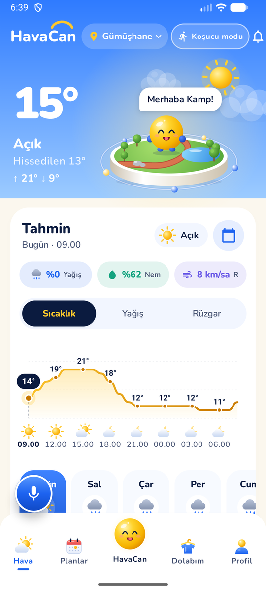
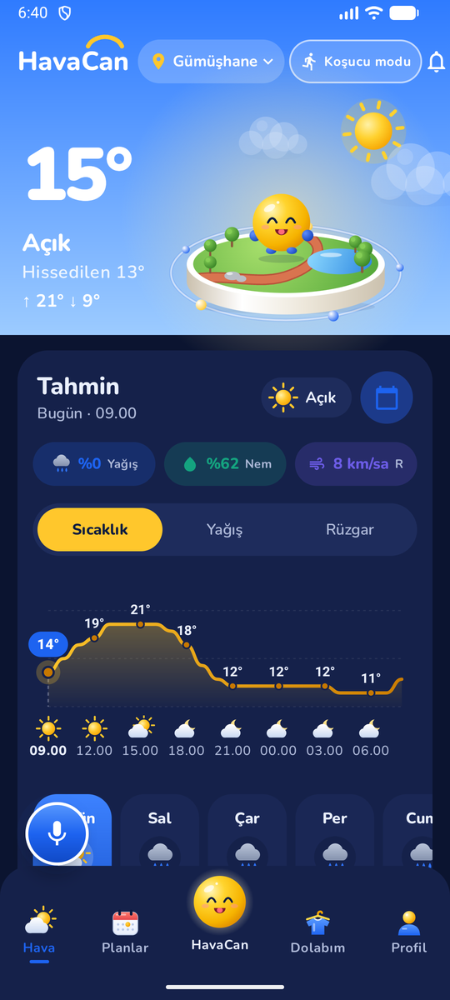
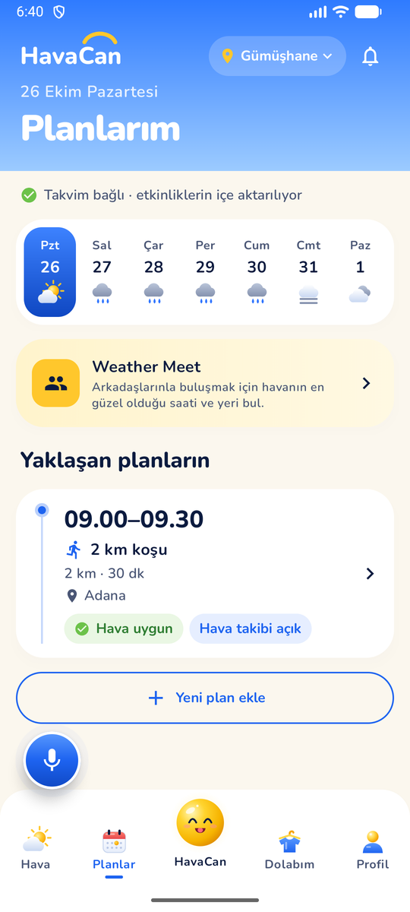
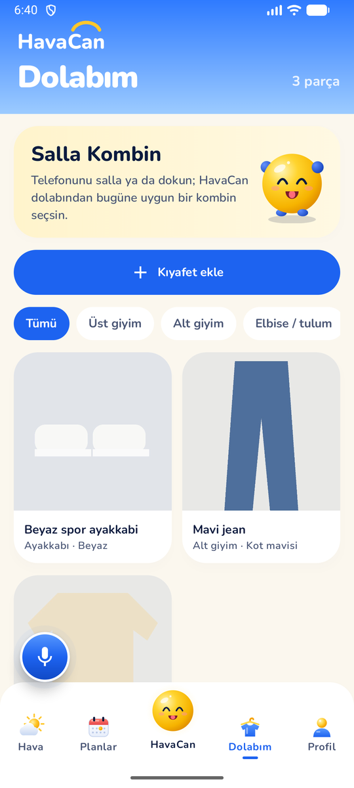
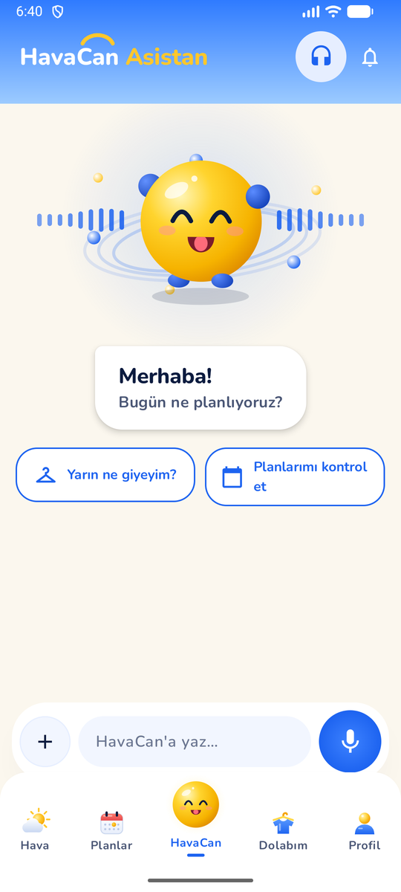

<div align="center">

# ☀️ HavaCan

**Havaya göre gününü planlayan, konuşan ve oyunlaştırılmış kişisel hava asistanı**

Turkcell × Gençlik ve Spor Bakanlığı **Kamp+** Android programı için geliştirildi.

[](https://github.com/bushushow/turkcell_camp/actions/workflows/android.yml)


[Özellikler](#özellikler) · [Mimari](#mimari) · [Çalıştırma](#çalıştırma) · [Testler](#testler) · [Veri ve gizlilik](#veri-kaynakları-ve-gizlilik) · [Kamp+ görevleri](#kamp-uygulamaları)

</div>

---

HavaCan, Open-Meteo'nun gerçek tahminini alıp onu **kararlara** çevirir: koşu için en iyi saat, planın yağmura denk gelip gelmediği, Plan B, arkadaşlarla buluşmak için herkese uyan saat, dolaptaki gerçek kıyafetlerden kombin. Sarı maskot **HavaCan** ekranda yaşar, sohbet eder ve sesli komutla bütün uygulamayı gezdirir.

> **Gerçek veri ilkesi.** Uygulamada demo verisi yoktur. Tahmin gelmezse puan ya da öneri uydurulmaz; ekranda nedeni ve "Tekrar dene" yazar. Kombinler yalnızca kullanıcının fotoğrafladığı kıyafetlerden kurulur.

<div align="center">

| Ana sayfa | Koyu tema | Planlarım | Dolabım | HavaCan Asistan |
|:---:|:---:|:---:|:---:|:---:|
|  |  |  |  |  |

<sub>Emülatörde gerçek Open-Meteo verisiyle alındı (Gümüşhane, 26 Ekim). Dolaptaki kıyafetler test için eklenmiş çizim fotoğraflardır.</sub>

</div>

## Özellikler

| | Özellik | Ne yapar | Kural nerede |
|---|---|---|---|
| 🏝️ | **Ana sayfa** | Canlı ada sahnesi, havaya ve saate göre renk alan gökyüzü, sıcaklık/yağış/rüzgar grafiği, 16 günlük gün şeridi. HavaCan'a dokununca gerçek veriden ipuçları verir | `domain/insight` |
| 🏃 | **Koşucu Modu** | Her saat için 0–100 koşu uygunluğu (hissedilen sıcaklık, yağış, rüzgar, UV, gün ışığı) ve en iyi pencere | `RunningSuitabilityCalculator` |
| 📅 | **Planlarım ve Plan B** | Planın saatindeki riski (yağmur, fırtına, kar, rüzgar, sıcak, soğuk) gösterir; ±4 saatte kuru bir saat önerir. Takvim etkinliklerini içe alır | `PlanAdvisor` |
| 🔔 | **Hatırlatma ve hava takibi** | Plan öncesi hatırlatma; hava bozulursa ya da düzelirse bildirim (uygulama kapalıyken de) | WorkManager |
| 👟 | **Koşu Planla** | Seçilen günün en uygun başlangıç saatleri, hedef mesafe, süre tekerleği, "koşudan ne kadar önce" hatırlatması | `RunSlotPlanner` |
| 👥 | **Weather Meet** | Arkadaşlar ve nereden gelecekleri eklenir; herkesin tahminine göre en uygun saat ve yer, kişi bazında hava, Plan B; davet paylaşılır | `MeetPlanner` |
| 👕 | **Dolabım ve Salla Kombin** | Galeriden ya da kameradan kıyafet; renk telefonda bulunur, yapay zekâ etiketleri önerir. Telefonu sallayınca havaya uygun kombin. Eksik parça varsa sahte kombin değil, eksik kategori gösterilir | `OutfitEngine` |
| 💬 | **HavaCan Asistan** | Yazılı ve sesli sohbet: hava, plan, kombin, koşu saati; plan oluşturma ve değiştirme (her değişiklik okunur, onay beklenir) | `HavaCanAssistant` |
| 🎙️ | **Sesli rehber** | Uygulama genelinde sesle gezinme; TalkBack açıksa yanıtları TalkBack okur. Sürüklenebilir mikrofon düğmesi | `VoiceCommandParser` |
| 📍 | **Konum seç** | 81 il ve 973 ilçe telefonda, internetsiz ve Türkçe karakter duyarsız arama; yurt dışı için Open-Meteo; "mevcut konumum" en yakın gerçek ilçeyi bulur | `PlaceDirectory` |
| 👤 | **Profil** | °C/°F, aktivite ve stil tercihleri, bildirim tercihleri, erişilebilirlik, gizlilik ve onaylı veri silme | `ProfileStore` |
| 🌗 | **Tema** | Açık ve koyu tema telefonun ayarını izler; bütün başlıklar gökyüzü renginde | `ui/theme` |

### Erişilebilirlik

- Bütün dokunma alanları en az 48 dp, simgelerin anlamlı `contentDescription`'ı var; bilgi yalnızca renkle verilmez.
- Profil'de **büyük yazı**, **yüksek kontrast** ve **animasyonları azalt**; Android'in animasyon ayarına da uyulur.
- Sesli rehber ve TalkBack birlikte çalışır: konuşma bitmeden mikrofon açılmaz.

## Mimari

İki Gradle modülü, dört katman. Ayrıntılar ve gerekçeler: **[docs/ARCHITECTURE.md](docs/ARCHITECTURE.md)**, kararlar: **[docs/adr/](docs/adr/)**.

```
ui (Route → Screen)  →  ViewModel (StateFlow)  →  Repository (arayüz)  →  Retrofit · Room · dosya · SharedPreferences
        │                      │
        └──── domain kuralları (saf Kotlin, birim testli) ◄────┘
```

| Modül | İçinde | Kural |
|---|---|---|
| `:core:domain` | `model/` · `domain/` | Saf Kotlin/JVM. Android, Room ya da Compose importu **derlenmez** |
| `:app` | `data/` · `di/` · `ui/` | Tek kurulum noktası `di/AppContainer`; ViewModel'ler yalnızca arayüzleri görür |

- **UI internete gitmez, ViewModel çizim yapmaz, repository ekranı bilmez.**
- Her ağ isteği tek bir `LoadState<T>` (Loading · Success · Empty · Error) ile gösterilir; hata ViewModel'de `ErrorReason`'a çevrilir.
- Ekranlar **Route + Screen** olarak ikiye ayrılır; Screen ViewModel tanımaz.
- Gezinme **Navigation Compose** ile; sesli komutlar da aynı rotaları kullanır.
- Global değişken durum yoktur: sıcaklık birimi ve ekran tercihleri profil akışından `CompositionLocal` ile gelir.

<details>
<summary><b>Paket yapısı</b></summary>

```
Weather/
├── core/domain/                          :core:domain (saf Kotlin)
│   └── com.kampplus.havacan
│       ├── model/                        City, Forecast, Plan, ClothingItem, MeetPerson, TemperatureUnit…
│       └── domain/
│           ├── plans/                    PlanAdvisor: risk ve Plan B
│           ├── running/                  RunningSuitabilityCalculator, RunSlotPlanner
│           ├── meet/                     MeetPlanner
│           ├── wardrobe/                 OutfitEngine, ClothingColors, ColorDetector
│           ├── insight/                  WeatherInsight
│           └── voice/                    VoiceCommandParser, HavaCanAssistant
└── app/                                  :app (Android)
    └── com.kampplus.havacan
        ├── di/AppContainer.kt            tek kurulum noktası
        ├── data/                         repository'ler, Retrofit, plan dosyası, profil, takvim, konum
        │   └── wardrobe/                 Room varlıkları ve DAO, fotoğraf deposu, yapay zekâ istemcisi
        └── ui/
            ├── navigation/               HavaRoutes
            ├── common/                   LoadState, ErrorReason, gökyüzü başlığı, gün şeridi
            ├── theme/                    açık/koyu palet, tipografi, DisplaySettings
            └── home · plans · run · meet · wardrobe · chat · voice · city · profile
```

</details>

### Teknoloji

| Alan | Kullanılan |
|---|---|
| Dil ve UI | Kotlin 2.2, Jetpack Compose (BOM 2026.02), Material 3, Canvas ile çizilen sahne ve karakter |
| Durum | ViewModel + `StateFlow`, Coroutines, `SavedStateHandle` |
| Gezinme | Navigation Compose |
| Ağ | Retrofit 3 + Gson, OkHttp |
| Kalıcılık | Room (dolap), atomik JSON dosyası (planlar), SharedPreferences (tercihler) |
| Arka plan | WorkManager (hatırlatma, 3 saatte bir hava takibi) |
| Sistem | Photo Picker, kamera, `SpeechRecognizer`, `TextToSpeech`, takvim, konum, bildirimler |
| Backend | Vercel'de küçük bir API (yapay zekâ anahtarını saklar) |
| Kalite | ktlint (Spotless), JUnit, kotlinx-coroutines-test, GitHub Actions |

## Çalıştırma

**Gereksinimler:** Android Studio (güncel), JDK 21 veya üzeri, Android SDK 37. Uygulama Android 7.0 (API 24) ve üzerinde çalışır.

```bash
git clone https://github.com/bushushow/turkcell_camp.git
cd turkcell_camp/Weather
./gradlew assembleDebug        # debug APK: app/build/outputs/apk/debug/
```

Android Studio'da `Weather/` klasörünü açıp **Run** ile de kurabilirsiniz.

**Yapay zekâ özellikleri (isteğe bağlı).** Kıyafet etiketi önerisi ve serbest sohbet için backend adresi gerekir. Adres olmadan uygulama eksiksiz çalışır: renk telefonda bulunur, etiketler elle girilir, sohbet kurala dayalı yanıt verir.

```properties
# Weather/local.properties  (Git'e girmez)
HAVACAN_API_URL=https://<backend-adresiniz>
```

Kendi backend'inizi kurmak için: [backend/havacan-api/README.md](backend/havacan-api/README.md).

**Emülatörde ses.** Sesli rehber için Extended controls → Microphone → *Enable Host Microphone Access* açılmalı ve Türkçe konuşma tanıma paketi yüklü olmalı (Settings → System → Languages → Speech).

## Testler

```bash
cd Weather
./gradlew spotlessCheck :core:domain:test testDebugUnitTest assembleDebug
```

**158 birim testi** (80'i `:core:domain`'de, 78'i `:app`'te) ve cihazda çalışan Room testi:

| Alan | Testler | Neyi korur |
|---|---|---|
| Kurallar | `PlanAdvisorTest`, `RunningSuitabilityCalculatorTest`, `RunSlotPlannerTest`, `MeetPlannerTest`, `OutfitEngineTest` | Risk eşikleri, koşu puanı, saat önerisi, buluşma sıralaması, yalnızca gerçek kıyafetlerden kombin |
| Asistan | `VoiceCommandParserTest`, `HavaCanAssistantTest` | Türkçe komutlar, onaysız değişiklik olmaması, internetsiz davranış |
| Veri | `ForecastMapperTest`, `CitySearchResponseTest`, `PlanStoreTest`, `PlaceDirectoryTest`, `TurkishProvincesTest`, `WardrobeDataTest`, `BackendAssistantTest` | JSON eşleme, sütun→satır çevrimi, atomik dosya yazımı, il/ilçe araması, yapay zekâ yanıtının doğrulanması |
| ViewModel | `HomeViewModelTest`, `PlansViewModelTest`, `RunPlannerViewModelTest`, `LocationPickerViewModelTest`, `VoiceGuideControllerTest` | Dört durum, "Tekrar dene", internetsiz kayıt, çift dokunmada tek kayıt, kalıcılık |
| Arayüz mantığı | `ForecastCardTest`, `HomeLogicTest`, `HavaCanTipsTest`, `HavaRoutesTest`, `UnitsTest` | Grafik verisi, ipuçları, rota tablosu, °C/°F |
| Cihazda | `WardrobeDaoTest` | Room'a yazılanın aynen geri okunması |

Testler ağı sahte `ForecastApi`/`CityApi` ile taklit eder; ortak yardımcılar `app/src/test/.../testing/` altında (`MainDispatcherRule`, `FakeLocationStore`, `RecordingScheduler`).

## Kalite kapıları

- **CI:** Her push ve PR'da [`.github/workflows/android.yml`](.github/workflows/android.yml): biçim kontrolü, iki modülün testleri, derleme ve backend sözdizimi.
- **Kod stili:** ktlint (Spotless), Kamp+ temel reposuyla aynı `.editorconfig`.
- **PR şablonu:** katman kuralları, durumlar, erişilebilirlik ve gizli anahtar kontrol listesi ([`.github/pull_request_template.md`](.github/pull_request_template.md)).
- **Commit'ler:** Conventional Commits; her commit neyin nasıl doğrulandığını yazar ([docs/GIT-HISTORY.md](docs/GIT-HISTORY.md)).

## Veri kaynakları ve gizlilik

| Kaynak | Kullanım | Lisans |
|---|---|---|
| [Open-Meteo Forecast](https://open-meteo.com/) | Anlık, 16 günlük saatlik ve günlük tahmin (`timezone=auto`) | CC BY 4.0 |
| [Open-Meteo Geocoding](https://open-meteo.com/en/docs/geocoding-api) | Yurt dışı yer araması | CC BY 4.0 |
| [GeoNames](https://www.geonames.org/) | 81 il ve 973 ilçenin listesi ve eksik koordinatlar | CC BY 4.0 |
| OpenRouter (backend üzerinden) | Kıyafet fotoğrafı etiketi, serbest sohbet | — |

Ayrıntı ve verinin yeniden üretilmesi: [docs/data-sources.md](docs/data-sources.md).

**Gizlilik ve güvenlik**

- **API anahtarı APK'da ve Git geçmişinde yoktur;** yalnızca backend'in ortam sırrındadır ([ADR-0003](docs/adr/0003-backend-for-secrets.md)).
- Kıyafet fotoğrafları uygulamanın özel klasöründe kalır. Backend kuruluysa, fotoğraf eklendiğinde etiket önerisi için 512 piksele küçültülmüş bir kopya backend'e gider; backend yoksa fotoğraf telefondan çıkmaz.
- Plan, kıyafet ve tercihler yalnızca telefonda tutulur; Profil'den onaylı olarak silinebilir.

| İzin | Ne zaman istenir | Neden |
|---|---|---|
| İnternet | Kurulumda | Hava tahmini |
| Bildirim | İlk plan kaydında | Hatırlatma ve hava uyarısı |
| Takvim (okuma) | "Takvimi bağla"ya dokununca | Etkinlikleri plan olarak almak |
| Mikrofon | İlk sesli komutta, açıklamadan sonra | Sesli rehber |
| Yaklaşık konum | "Mevcut konumumu kullan"a dokununca | En yakın ilçeyi bulmak |

## Kamp+ uygulamaları

Zorunlu uygulamaların teslim anları etiketlidir; kanıtlar (ekran görüntüleri, Logcat) `docs/kamp/` altında.

| Etiket | Görev | Kanıt |
|---|---|---|
| `kamp-uygulama-2` | "Merhaba Kamp!", şehir kartları, `LazyColumn`, tıklama kaydı | [docs/kamp/uygulama-2](docs/kamp/uygulama-2/README.md) |
| `kamp-uygulama-3` | Arama, `remember` / `rememberSaveable`, filtre, boş durum | [docs/kamp/uygulama-3](docs/kamp/uygulama-3/README.md) |
| `kamp-uygulama-4` | Retrofit ile Open-Meteo arama, ViewModel, dört durum | [docs/kamp/uygulama-4](docs/kamp/uygulama-4/README.md) |

Diğer etiketler: `pre-architecture-final` (mimari düzenlemeden önceki son hal).

## Depo yapısı

```
turkcell_camp/
├── Weather/            Android projesi (:app, :core:domain)
├── backend/havacan-api Yapay zekâ anahtarını saklayan küçük API (Vercel; Cloudflare girişi de var)
├── docs/               Mimari, ADR'ler, Git stratejisi, veri kaynakları, Kamp+ kanıtları, tasarım taslakları
├── tools/places/       İl ve ilçe verisini GeoNames'ten üreten betikler
└── .github/            CI ve PR şablonu
```

## Bilinen sınırlar

- WorkManager kesin saatli değildir; pil tasarrufunda hatırlatma birkaç dakika gecikebilir.
- Tahmin önbelleği yalnızca bellekte (10 dk); internet yokken eski tahmin gösterilmez, hata gösterilir.
- Weather Meet'te katılımcılar uygulama içinde oy vermez (hesap ve sunucu gerektirir); öneri paylaşılan davetle iletilir.
- HavaCan karakteri ve sahneler Canvas çizimidir; gerçek 3D asset'ler ve uygulama simgesi henüz yok ([docs/havacan-assets.md](docs/havacan-assets.md)).
- Veri kaynaklarının uygulama içi tam atıf sayfası (Profil › Hakkında) henüz yok; atıflar bu README'de ve `docs/data-sources.md`'de.
- `applicationId` demo cihazındaki verileri korumak için şimdilik `com.example.weather`; kod paketi `com.kampplus.havacan`.

## Lisanslar

Veri kaynaklarının lisansları yukarıda. Nunito yazı tipi SIL Open Font License 1.1 ile kullanılır ([docs/licenses/Nunito-OFL.txt](docs/licenses/Nunito-OFL.txt)).
